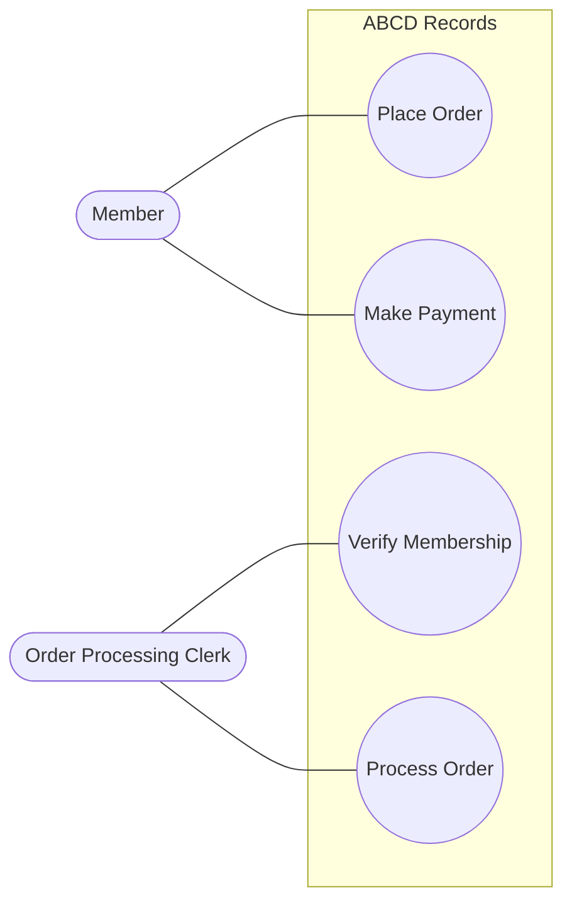
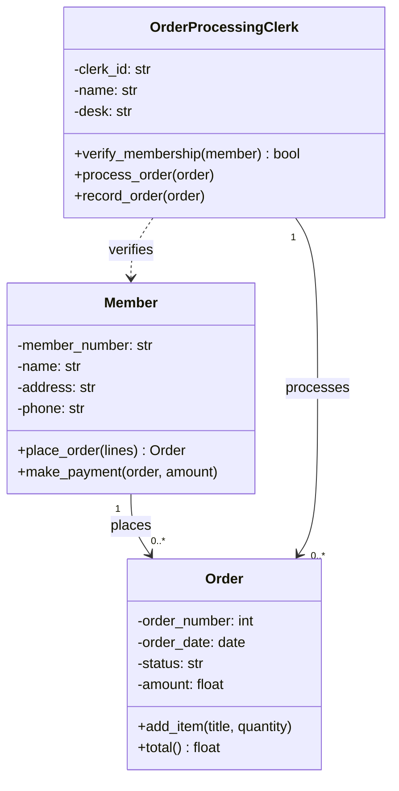
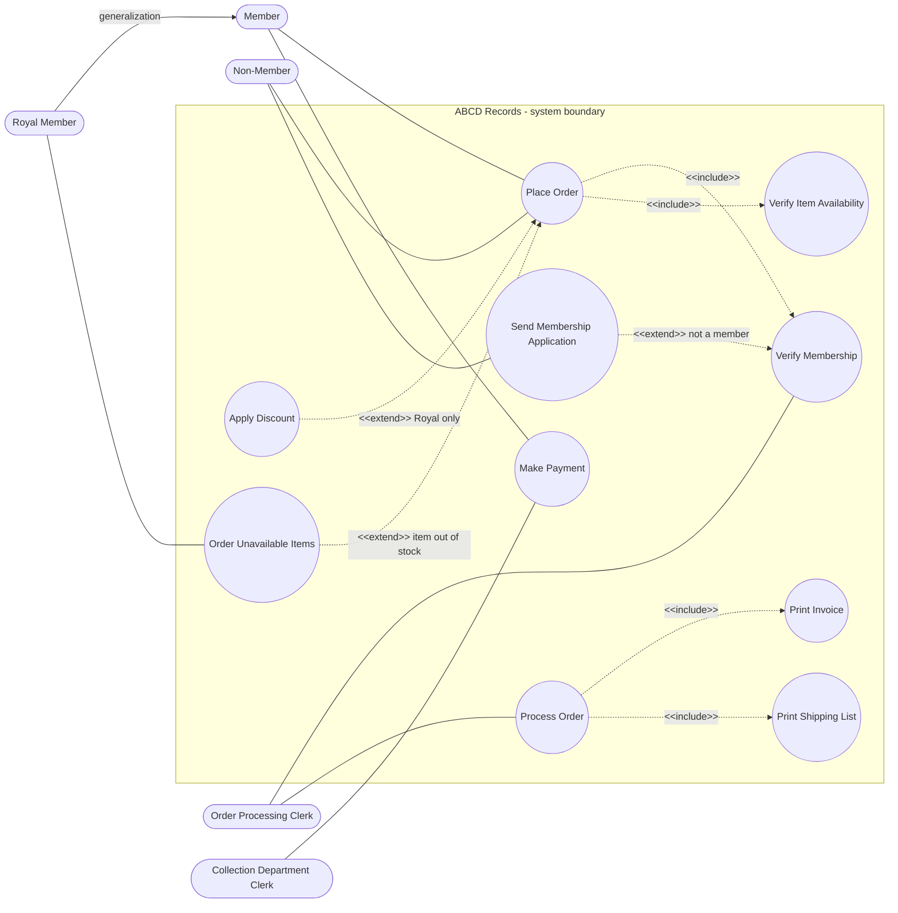
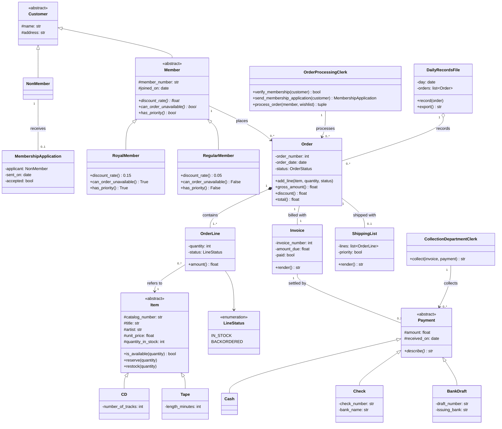
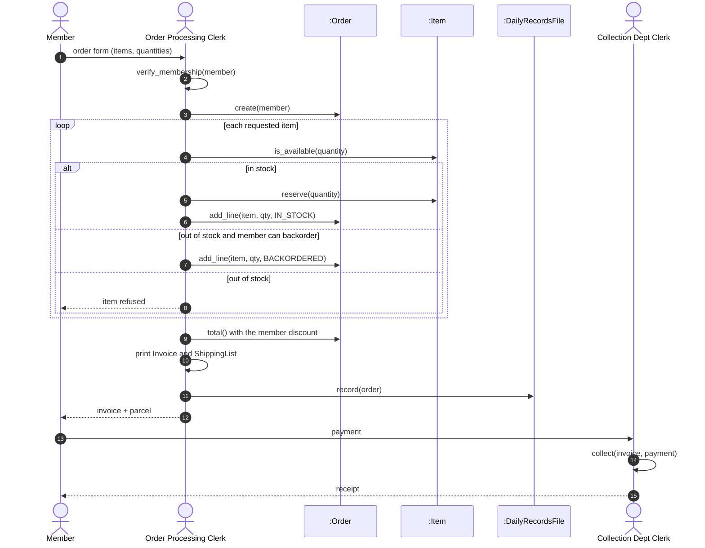
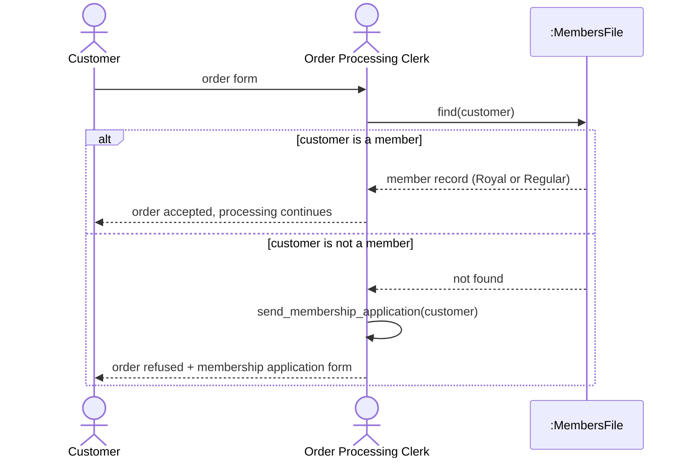
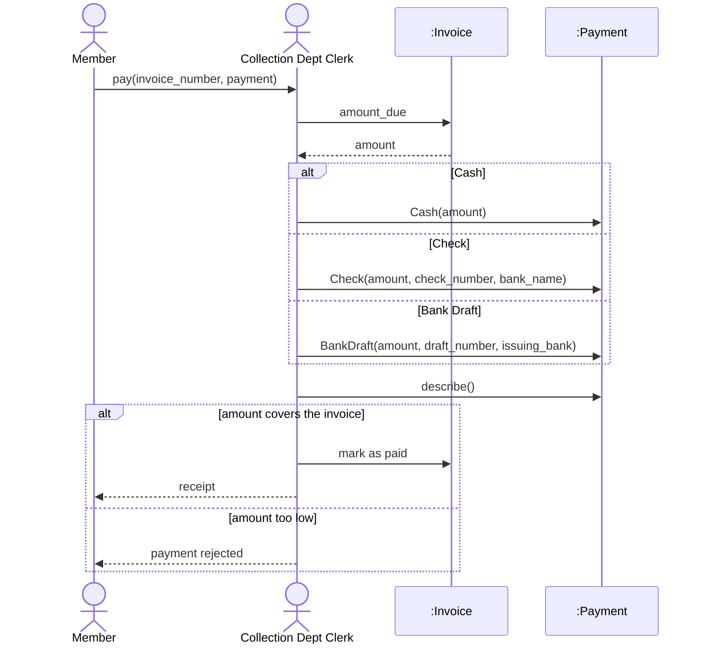
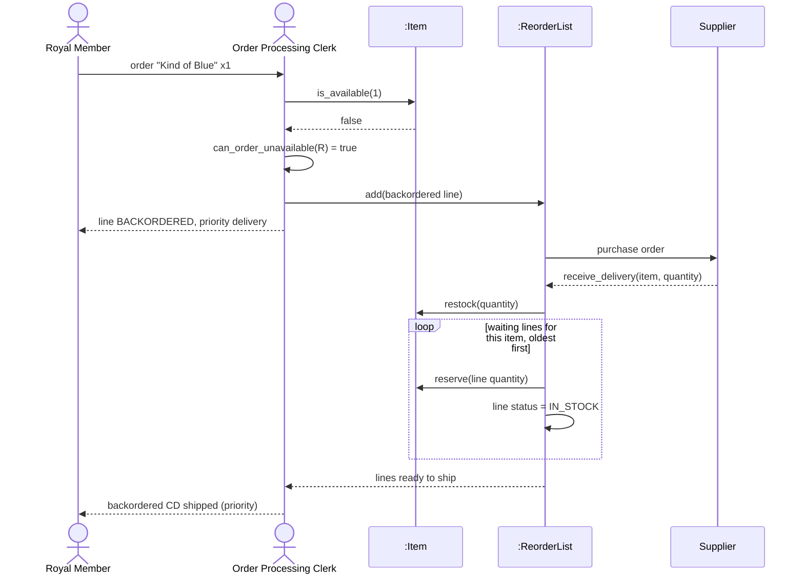

# Exercise 2 - ABCD Records 💿

Statement: https://gist.github.com/bdallard/2d2407c4de4c182afca6d3ec7235e9eb (slide 68) · Code: [`abcd_records.py`](abcd_records.py)

ABCD Records sells CDs and tapes by mail order, at discount prices, to record club members. Rules: only members order, non-members get an application form, Royal members (discount + priority, can order unavailable items) vs Regular members, payment by cash / check / bank draft, an Order Processing Clerk verifies and processes, a Collection Department Clerk handles payments, every order goes into a daily records file.

> **About the use case diagrams:** Mermaid has no real use case diagram, so I draw them as flowcharts: actors are stadium shapes, use cases are circles/ovals, the big box is the **system boundary**, and dotted arrows carry `<<include>>` / `<<extend>>`. `include` points from the base use case to the included one, `extend` points from the optional use case to the base one (like in UML).

## Level 1

### Task 1.1 - simple use case diagram

### Task 1.2 - basic class diagram

## Level 2

### Task 2.1 - complete use case diagram

- `<<include>>` = always done as part of the base use case: *Place Order* always verifies the membership and the item availability, *Process Order* always prints the invoice and the shipping list.
- `<<extend>>` = only under a condition: *Apply Discount* and *Order Unavailable Items* extend *Place Order* only for Royal members, *Send Membership Application* extends *Verify Membership* only when the customer is not a member.
- `Royal Member` is a specialization of `Member` (generalization arrow), it can do everything a member does plus the two Royal use cases.

### Task 2.2 - complete class diagram

Choices:
- `Customer` is the common parent of `NonMember` and `Member`, because both have a name and an address and a non-member can try to order. `Member` is abstract with two concrete types.
- Each member type answers `discount_rate()` and `can_order_unavailable()` itself (polymorphism, no `if member_type == "royal"`).
- `Order *-- OrderLine` is a composition (a line has no meaning without its order); a line points to one `Item`.
- `LineStatus` says if a line is shipped now (`IN_STOCK`) or later (`BACKORDERED`).

#### Scenario: a Royal member orders 2 CDs, one is unavailable, and pays by check

| Step | Who | What happens in the model |
|---|---|---|
| 1 | Royal member | asks for CD "Thriller" (in stock) and CD "Kind of Blue" (out of stock) |
| 2 | Order clerk | `verify_membership()` → it's a `RoyalMember`, OK |
| 3 | Order clerk | "Thriller" is available → line `IN_STOCK`, stock decreases |
| 4 | Order clerk | "Kind of Blue" is not available, but `can_order_unavailable()` is `True` for Royal → line `BACKORDERED` (a regular member would get nothing for this line) |
| 5 | System | discount 15% on the total, `Invoice` with the amount due, `ShippingList` with only "Thriller", marked priority |
| 6 | Order clerk | the order is written in the `DailyRecordsFile` |
| 7 | Collection clerk | receives a `Check` for the exact amount → invoice paid, order status `PAID` |

This scenario is the `__main__` of `abcd_records.py` and is also a test.

## Level 3 - advanced sequence diagrams

### 1. Complete order processing

### 2. Membership verification (success and failure)

### 3. Payment processing (all payment types)

### 4. Item reordering for Royal members

