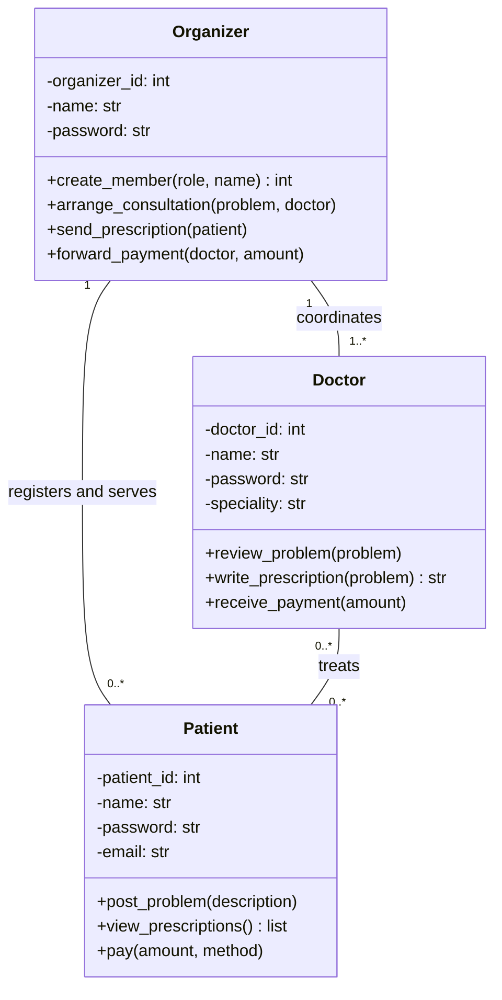
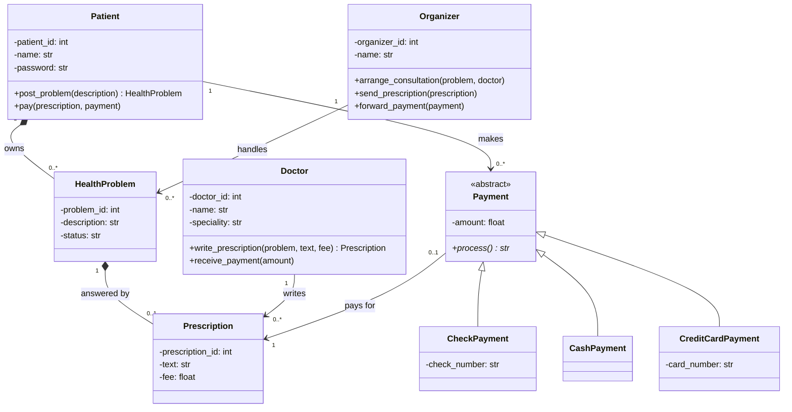
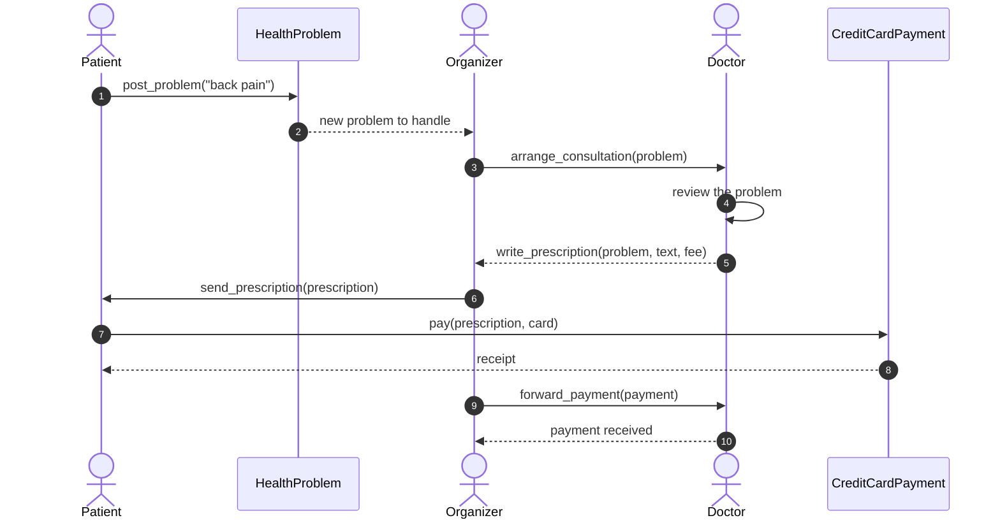
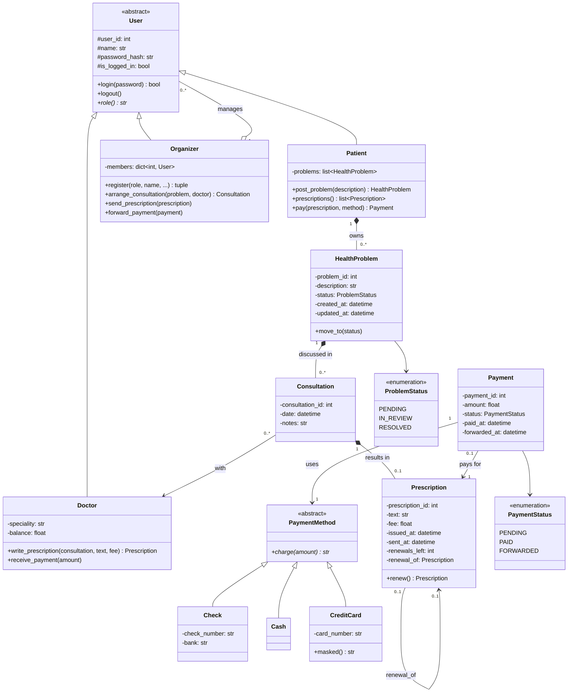
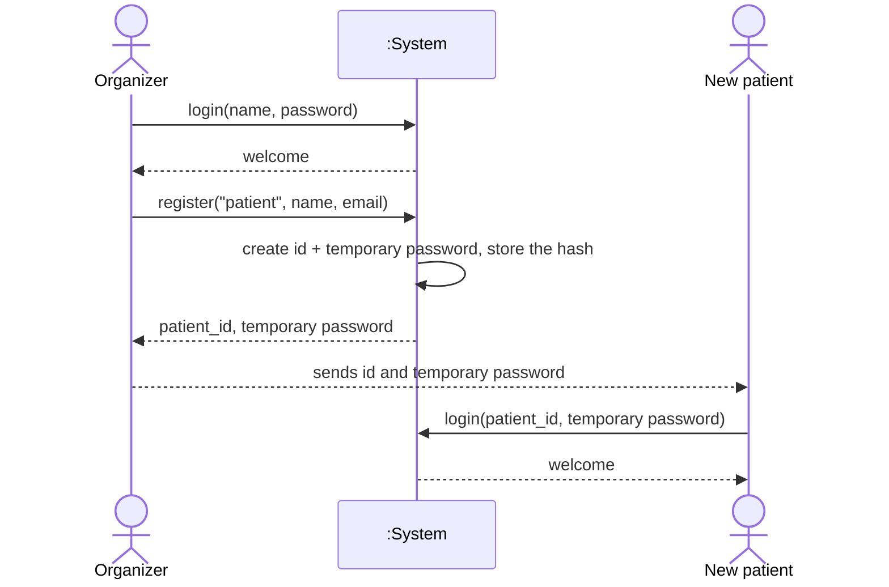
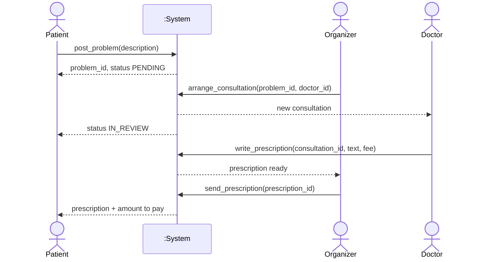
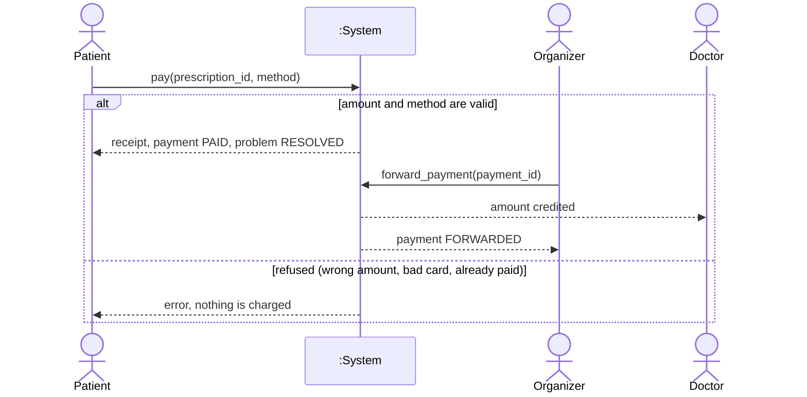

# Exercise 1 - Hospital Management System 🏥

Statement: https://gist.github.com/bdallard/2d2407c4de4c182afca6d3ec7235e9eb (slide 68) · Code: [`hospital.py`](hospital.py)

Workflow to model: patient posts a problem → organizer arranges a consultation → doctor gives a prescription → organizer sends it to the patient → patient pays (check, cash or card) → organizer forwards the money to the doctor. The organizer is also the administrator (creates members, ids, passwords).

## Basic architecture - Task 1: class diagram

Who talks to whom: the patient only deals with the organizer (posts problems, receives prescriptions, pays), the organizer deals with the doctors, and the doctor treats patients through the organizer.

## Develop the system - Task 2: extended class diagram

Six classes: Patient, Doctor, Organizer + HealthProblem, Prescription, Payment.

- **Composition** `Patient *-- HealthProblem`: a problem is part of the patient's file and has no meaning without the patient.
- **Composition** `HealthProblem *-- Prescription`: a prescription is the answer to one problem.
- **Inheritance** for the payment types (`CheckPayment`, `CashPayment`, `CreditCardPayment`), because each type has its own data (check number, card number).

### Task 2: sequence diagram - one patient submits a problem, gets a prescription and pays

## Advanced - Task 3

Refinements I added:

- `User` abstract superclass with the shared attributes (`id`, `name`, password hash) and `login()` / `logout()`.
- **Strategy with composition** for payments: a `Payment` is the record (amount, status, timestamps) and it *has* a `PaymentMethod` (`Check`, `Cash`, `CreditCard`). Each method implements `charge()` differently, so the code that handles a payment never does `if method == "check"`.
- `ProblemStatus` (PENDING → IN_REVIEW → RESOLVED) and `PaymentStatus` (PENDING → PAID → FORWARDED) enums.
- Timestamps on problems, prescriptions and payments, and `renewal_of` on a prescription to point to a past prescription.
- `Consultation` between `HealthProblem` and `Doctor` so one problem can be seen by several doctors (question 1).

### System sequence diagrams

In a system sequence diagram the system is a black box: only the actors and `:System`, with the messages they exchange.

#### 1. Patient registration (the organizer creates a new member)

#### 2. Consultation flow (problem submitted → prescription delivered)

#### 3. Payment processing (patient pays, organizer forwards to the doctor)

## Questions to consider

1. **A patient consulting multiple doctors?** Different problems can already go to different doctors. For the same problem (second opinion, specialist), I put a `Consultation` class between `HealthProblem` and `Doctor`: one problem has `0..*` consultations and each consultation is with one doctor, so it is a many-to-many relation with its own data (date, notes, prescription).
2. **Should prescriptions be reusable?** A prescription should not be edited once it is sent (it's a medical and billing record). For a treatment that must be repeated, the doctor sets `renewals_left`, and `renew()` creates a **new** prescription that points to the old one with `renewal_of`. We get reuse and a complete history.
3. **Which design pattern for the payment system?** **Strategy**: `Payment` delegates to a `PaymentMethod` object and each method (`Check`, `Cash`, `CreditCard`) implements `charge()`. Adding PayPal = one new class, nothing else changes (Open/Closed). A small **Factory** can build the right method from the form value ("check", "cash", "card").
4. **Data integrity when payments are processed?**
   - a status machine: a payment can only go PENDING → PAID → FORWARDED, so it can't be paid twice or forwarded before being paid
   - the amount is checked against the prescription fee before charging
   - in a real database, "mark as paid" and "credit the doctor" run in one **transaction** (both or nothing)
   - an idempotency key / unique constraint on (prescription, payment) so a double click does not create two payments
   - timestamps for every step (audit trail), and card numbers are never stored in clear (only the last 4 digits)
