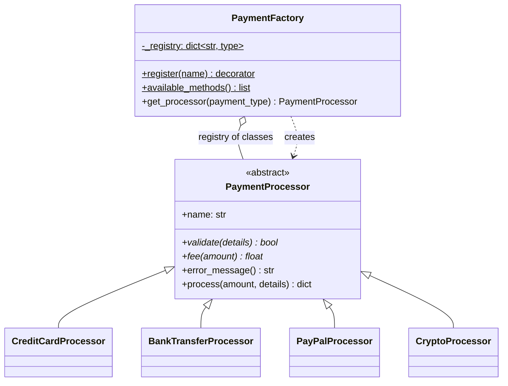
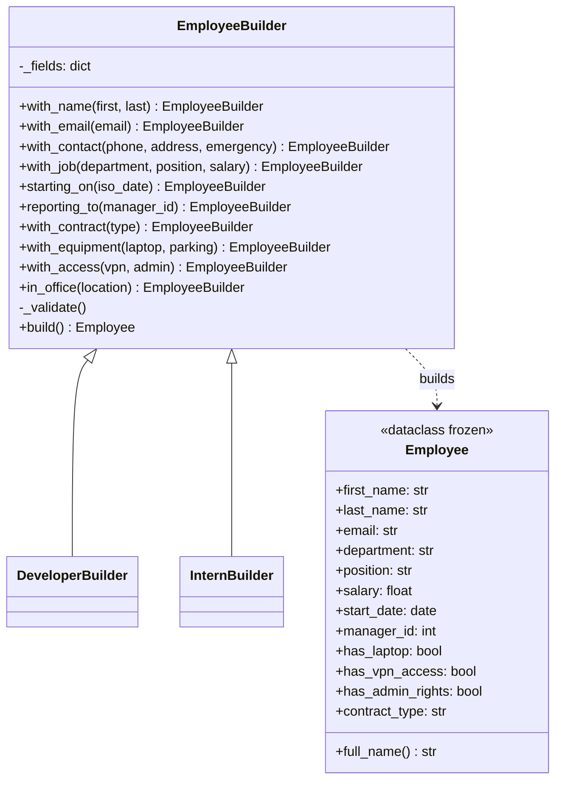
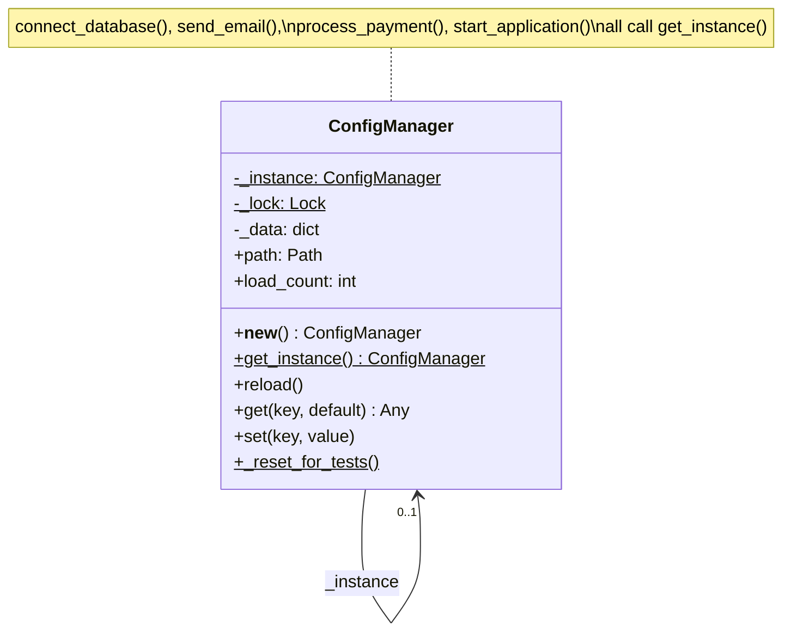
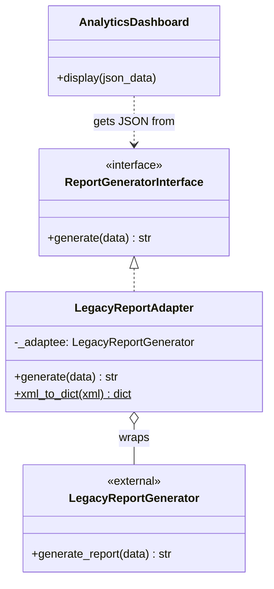
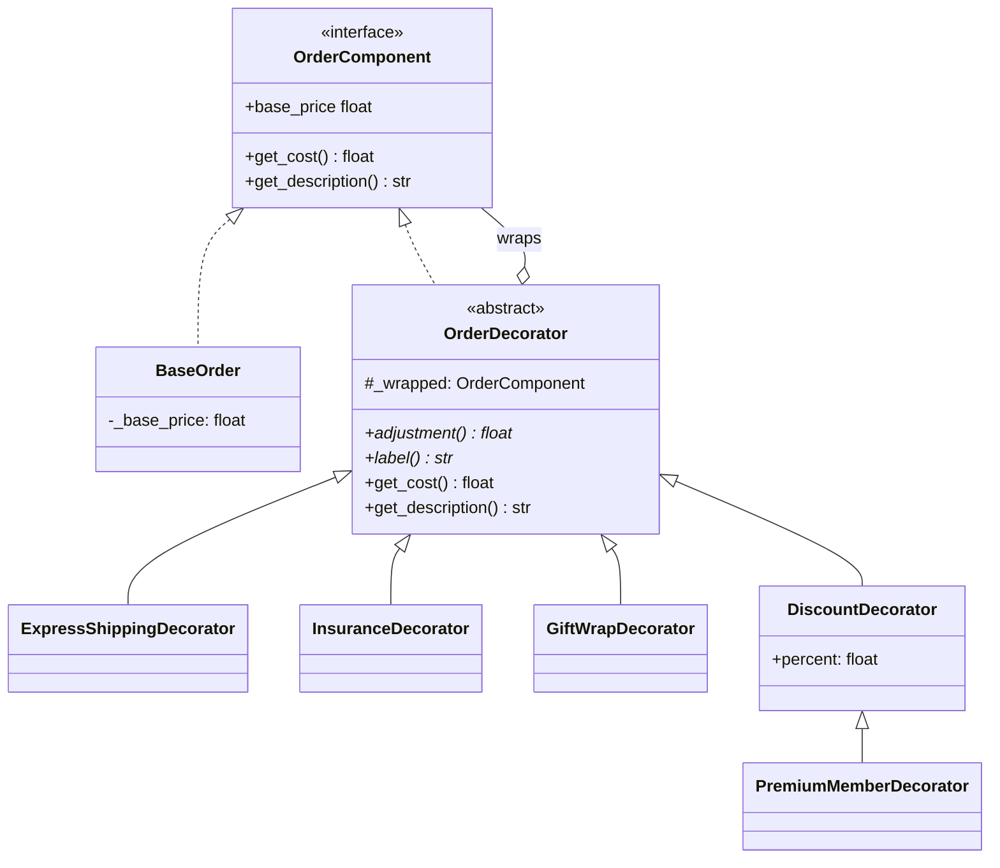
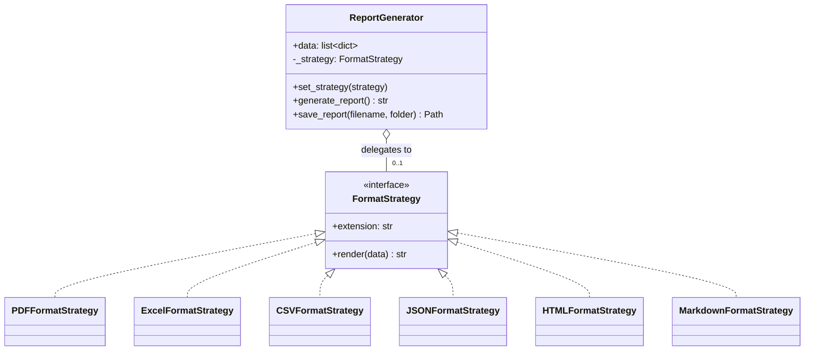
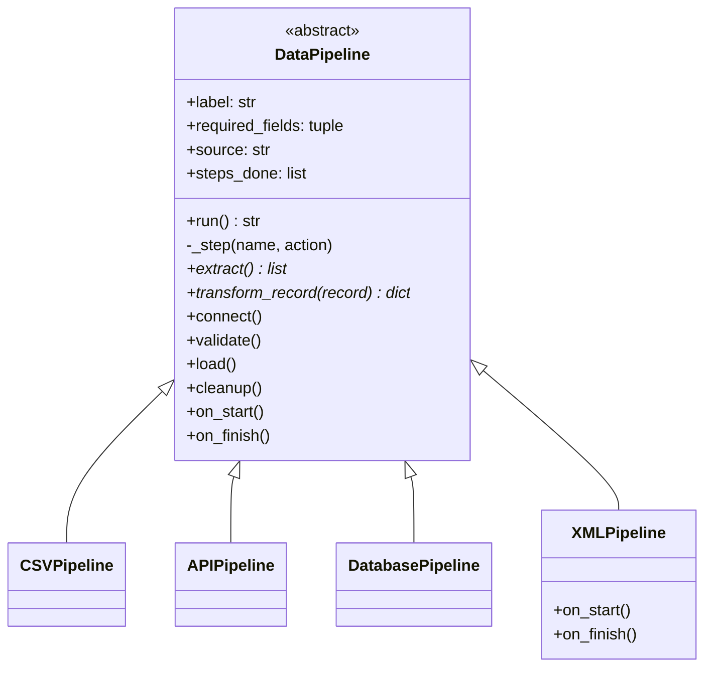

# 05 - Design patterns

Statements (course website):
[Creational patterns](https://courses.dallard.tech/sys_design/creational_pattern/) ·
[Structural patterns](https://courses.dallard.tech/sys_design/structural_pattern/) ·
[Behavioral patterns](https://courses.dallard.tech/sys_design/behavioral_pattern/) (slides 70-87)

Each file starts with the answers to "problems to identify", then the refactored code, then a `__main__` that reproduces the "expected usage" of the statement. The UML diagram of each solution is below (drawn before coding, as asked).

| Family | Pattern | Exercise | Code | Tests |
|---|---|---|---|---|
| Creational | Factory | payment system | [`factory_payment.py`](creational/factory_payment.py) | [`test_creational.py`](creational/test_creational.py) |
| Creational | Builder | HR employee onboarding | [`builder_employee.py`](creational/builder_employee.py) | ″ |
| Creational | Singleton | configuration manager | [`singleton_config.py`](creational/singleton_config.py) + [`config.json`](creational/config.json) | ″ |
| Structural | Adapter | legacy XML reports → JSON dashboard | [`adapter_report.py`](structural/adapter_report.py) | [`test_structural.py`](structural/test_structural.py) |
| Structural | Decorator | order pricing options | [`decorator_order.py`](structural/decorator_order.py) | ″ |
| Behavioral | Strategy | multi-format reports | [`strategy_report.py`](behavioral/strategy_report.py) | [`test_behavioral.py`](behavioral/test_behavioral.py) |
| Behavioral | Template Method | ETL pipelines | [`template_etl.py`](behavioral/template_etl.py) | ″ |

```bash
python3 creational/factory_payment.py      # same for every file
python3 -m pytest                          # 52 tests
```

---

## Factory - payment system

**Problem:** one `process_payment()` with an `if/elif` per method. Adding Apple Pay or crypto means editing the function that every payment goes through (Open/Closed violated), and validation + fees + response are mixed.

**Solution:** an abstract `PaymentProcessor` (`validate()`, `fee()`, and a shared `process()`), one class per method, and a `PaymentFactory` that maps a string to a class with a **dictionary**. Classes add themselves to the dictionary with the `@PaymentFactory.register("name")` decorator, so the factory is never edited again: I added `crypto` this way.



## Builder - HR onboarding

**Problem:** a "telescoping constructor" with 17 positional parameters: one missing `None` shifts all the others, `False, True, True, True` is unreadable, and rules like "an intern never has admin rights" can't be enforced.

**Solution:** `Employee` is a frozen dataclass (the product). `EmployeeBuilder` has small chainable methods that all `return self`, and `build()` validates everything in one place, including the business rules (intern ≠ admin, VPN needs a laptop). `DeveloperBuilder` and `InternBuilder` are presets that can still be adjusted before `build()`.



## Singleton - configuration manager

**Problem:** `config.json` is read 4 times per request, each module has its own copy, a change in one module is invisible to the others, and there's no single point to mock in tests.

**Solution:** `ConfigManager` keeps its only instance in a class attribute. `__new__` always returns that instance (even `ConfigManager()`), `__init__` loads the file only the first time, and a lock makes the creation thread-safe. `get("database.host")` walks the nested dict, `set()` changes a value for everyone. `_reset_for_tests()` lets the tests load a temporary file.



## Adapter - legacy XML → JSON dashboard

**Problem:** the legacy generator (external library, can't change it) returns XML, the dashboard expects JSON. The original code "converted" by calling `json.dumps(report_data)` on the original dict, so the XML was just thrown away, and that hack was repeated in every function.

**Solution:** `ReportGeneratorInterface.generate(data) -> JSON` is what the new code expects. `LegacyReportAdapter` implements it, **wraps** a `LegacyReportGenerator` (composition = object adapter), parses its XML with `ElementTree` and restores the types (`"1234"` → `1234`). The business functions only know the interface.



## Decorator - order pricing

**Problem:** 5 boolean flags in `calculate_total()`; each new option = one more parameter and one more `if`; the insurance logic can't be reused; and the order of operations (discount before or after shipping?) is hidden in the code.

**Solution:** `OrderComponent` (`get_cost()`, `get_description()`), `BaseOrder`, and an abstract `OrderDecorator` that wraps a component. Each concrete decorator only defines `adjustment()` and `label()`, the base decorator does the delegation. The order in which decorators are wrapped **is** the order of calculation, so it's visible. Insurance uses `base_price` (passed through the chain) so it's 5% of the item price like in the original code, even with the wrapping order of the statement.



## Strategy - report formats

**Problems** (answered in detail at the top of the file): two `if/elif` chains to keep in sync, Open/Closed violated, impossible to test one format alone, formats chosen with magic strings, duplicated `with open(...)` blocks.

**Solution:** `FormatStrategy` (with `extension` and `render(data)`), one class per format, and `ReportGenerator` as the context with `set_strategy()`, `generate_report()` and a single `save_report()`. Final test of the statement: `HTMLFormatStrategy` (and `MarkdownFormatStrategy`) were added without touching the other classes.



## Template Method - ETL pipelines

**Problems** (answered in the file): validation and cleanup copied 3 times, logging or a new step would need 3 edits, nothing guarantees the order of the steps, about 3/4 of each class is duplicated.

**Solution:** `DataPipeline.run()` is the template method: on_start → connect → extract → transform → validate → load → cleanup → on_finish. Subclasses only implement `extract()` and `transform_record()` (one record at a time) and set `required_fields`. `on_start()` / `on_finish()` are hooks (empty by default). Every step goes through `_step()`, the one place to add logging for all pipelines. The new `XMLPipeline` proves it: only the XML-specific parts are written, and it uses both hooks.



## Summary in one sentence each

- **Factory**: the code asks "give me a processor for X" and doesn't know the concrete classes.
- **Builder**: build a complex object step by step, validate once at the end.
- **Singleton**: one shared instance, one global access point (to use carefully: it's global state).
- **Adapter**: make an existing class fit the interface the client expects, without changing it.
- **Decorator**: add behaviour by wrapping an object, options can be combined in any order.
- **Strategy**: one family of interchangeable algorithms, chosen at runtime.
- **Template Method**: the parent fixes the steps, the children fill in the specific ones.
